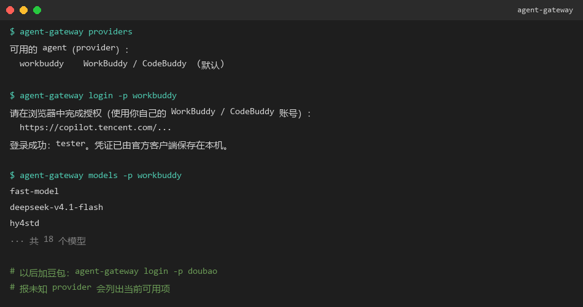
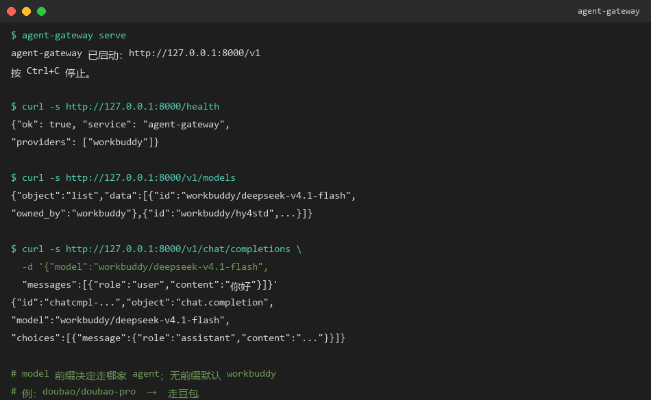

# agent-gateway

[](https://github.com/timolyx/agent-gateway/actions/workflows/test.yml)
[](https://www.python.org/)
[](LICENSE)

把 **AI Agent 订阅里的模型**（目前是 WorkBuddy / CodeBuddy，后续会加豆包、千问、百度搭子等）暴露成一个本地 **OpenAI 兼容 API**。任何支持自定义 Base URL 的客户端（Claude Code、OpenAI SDK、LangChain、各类前端应用等）都能直接接入。

```text
你的客户端 ──OpenAI 协议──> agent-gateway (127.0.0.1:8000/v1) ──官方协议──> 各个 Agent 云端
                                    │
                     model: "doubao/doubao-pro"  ← 前缀决定走哪家
```

## 截图预览

命令行：



启动服务后即可用标准 OpenAI 接口调用：



## 一键速览

```bash
agent-gateway providers    # 看有哪些 agent 可用
agent-gateway login        # 浏览器里用你自己的账号授权一次（默认 workbuddy）
agent-gateway serve        # 启动 API：http://127.0.0.1:8000/v1
```

```bash
curl http://127.0.0.1:8000/v1/chat/completions \
  -H "Content-Type: application/json" \
  -d '{"model":"workbuddy/deepseek-v4.1-flash","messages":[{"role":"user","content":"你好"}]}'
```

---

## ⚠️ 请先读：定位与边界

理解这一点很重要，能避免误用：

- **本项目不是任何厂商的官方产品**，也不提供任何账号或模型。它只是一个"协议转换器"：把 OpenAI 格式的请求翻译成各 Agent 客户端本来就在用的调用。
- **每个使用者必须用 `login` 命令，在自己的浏览器里、用自己的账号授权**。登录走官方 SDK 的标准浏览器 OAuth 流程。
- **本项目不含、不内置、不分发任何 token 或账号**。凭证由官方客户端写入你自己机器的标准位置，本项目只读取它；`.gitignore` 已排除所有凭证文件。
- **请遵守对应服务条款**，用你有权使用的账号与配额，不要用于账号共享、批量转售或规避服务限制。
- 由于依赖官方客户端的登录态与私有端点，接口可能随官方版本变化；本项目的稳定性不及正式 API。

为什么这样设计：市面上能"免登录直接给出模型"的方案，本质都是复制某一个人的登录凭证。那种 token 会过期、会失效，还会把别人的账号暴露给陌生人——既不可用也不合规。让每个人登自己的账号，是唯一能长期稳定工作的方式。

## 功能

- **多 Agent 架构**：一个网关接入任意多个 agent，加新 agent 只需新增一个 provider 模块
- 浏览器 OAuth 登录（官方 SDK，跨平台）
- OpenAI 兼容的 `/v1/models` 与 `/v1/chat/completions`
- **模型名带 `provider/` 前缀路由**，解决不同 agent 模型重名问题；无前缀默认走 workbuddy
- 同时支持**流式**（SSE）与非流式调用
- 凭证即将过期时自动续期；被拒绝时自动续期并重试
- 只读取本机登录态，token **永不**写进项目目录、日志或响应
- 端点白名单校验，防止 token 被发往非官方主机

## 安装

需要 Python 3.10 及以上。

```bash
git clone https://github.com/timolyx/agent-gateway.git
cd agent-gateway
python -m venv .venv

# Windows
.venv\Scripts\activate
# macOS / Linux
source .venv/bin/activate

pip install -e .
```

`pip install -e .` 会自动安装 `codebuddy-agent-sdk`。它内含 Windows / macOS / Linux 的 CLI 二进制，所以本项目**不要求**你另外安装 WorkBuddy 桌面版或 Docker。

## 使用

### 1. 查看可用 agent

```bash
agent-gateway providers
```

输出（当前内置 workbuddy，以后会更多）：

```text
可用的 agent（provider）：
  workbuddy    WorkBuddy / CodeBuddy  (默认)
```

### 2. 登录（每个 agent、每个使用者一次）

```bash
agent-gateway login               # 等价于 -p workbuddy
agent-gateway login -p workbuddy  # 显式指定
```

会打印一个官方授权地址并尝试自动打开浏览器。用你自己的账号完成授权即可。若没自动弹出，手动复制地址到浏览器。

- 只想拿地址、不自动开浏览器：`agent-gateway login -p workbuddy --no-browser`
- 授权等待超时可调：`agent-gateway login -p workbuddy --timeout 600`

查看状态与模型（加 `-p` 指定 agent，省略则默认 workbuddy）：

```bash
agent-gateway status
agent-gateway models -p workbuddy
```

登录某个还不存在的 agent 会明确报错并列出可用项：

```bash
agent-gateway login -p doubao
# 未知的 provider：doubao。可用：workbuddy
```

### 3. 启动服务

```bash
agent-gateway serve
# 自定义地址与端口
agent-gateway serve --host 127.0.0.1 --port 8000
```

启动后，API 根地址为 `http://127.0.0.1:8000/v1`。**服务进程需保持运行**，关掉就停止了。服务是**统一入口**，不需要为不同 agent 各开一个端口。

### 4. 用模型名前缀选 agent

客户端在 `model` 字段用 `provider/模型名` 指定走哪家：

| 写法 | 含义 |
|---|---|
| `workbuddy/deepseek-v4.1-flash` | 走 WorkBuddy |
| `doubao/doubao-pro` | 走豆包（ provider 就绪后） |
| `deepseek-v4.1-flash`（无前缀） | 默认走 workbuddy，向后兼容 |
| `custom_xxx/model` | FCC 传来的格式，归到默认 provider |

凡是能填"OpenAI 兼容 / 自定义 Base URL"的地方：

| 配置项 | 值 |
|---|---|
| Base URL | `http://127.0.0.1:8000/v1` |
| API Key | 任意填写（本项目不校验，鉴权用本机登录态） |
| 模型名 | `workbuddy/deepseek-v4.1-flash` 等，见 `agent-gateway models -p workbuddy` |

**OpenAI SDK 示例：**

```python
from openai import OpenAI

client = OpenAI(base_url="http://127.0.0.1:8000/v1", api_key="unused")
resp = client.chat.completions.create(
    model="workbuddy/deepseek-v4.1-flash",
    messages=[{"role": "user", "content": "用一句话介绍你自己"}],
)
print(resp.choices[0].message.content)
```

**接入 free-claude-code / FCC 的 Custom provider：**

- Base URL：`http://127.0.0.1:8000/v1`
- API format：`Chat Completions`
- API keys：留空
- Model IDs：留空自动发现，或填 `deepseek-v4.1-flash`
- 保存后，在 Model Config 把 `MODEL` 设为 `custom_<ID>/deepseek-v4.1-flash`（无 provider 前缀时走默认 workbuddy）

## 配置（可选）

全部通过环境变量，无需改代码：

| 变量 | 作用 | 默认 |
|---|---|---|
| `AGENT_GATEWAY_PORT` / `--port` | 服务端口 | 8000 |
| `AGENT_GATEWAY_MODELS` | 覆盖模型列表（英文逗号分隔） | 自动读取本机缓存，否则用内置清单 |
| `AGENT_GATEWAY_BASE_URL` | 强制指定云端端点 | 自动判断国内/海外 |
| `AGENT_GATEWAY_AUTH_FILE` | 指定登录态文件路径 | 自动搜索标准位置 |
| `CODEBUDDY_INTERNET_ENVIRONMENT` | `internal`/`ioa` 时走国内端点 | 自动 |

## 扩展：接入新的 agent

架构已经为多 agent 预留好。新增一家（例如豆包）只需三步，命令与主服务都不用改：

1. 新建模块实现 `wbapi.base.Provider` 的四个方法：`login` / `status` / `list_models` / `stream_chat`。可参考 `provider.py` 里的 `WorkBuddyProvider`。
2. 在 `wbapi/registry.py` 的 `_bootstrap()` 里注册它。
3. 用户即可 `agent-gateway login -p doubao`，客户端用 `doubao/模型名` 调用。

## 常见问题

**`login` 提示缺少 SDK？** 先执行 `pip install -e .`。

**`status` 显示未登录？** 本机没有该 agent 的登录态。运行 `agent-gateway login -p <agent>` 完成一次授权。

**提示"未知的 provider"？** 先运行 `agent-gateway providers` 看当前支持哪些 agent。

**`serve` 起来了但调用报 502？** 看错误信息：若是登录态问题，重新 `login`；若提示续期过期，也需重新 `login`。

**会上传我的 token 吗？** 不会。token 只用于向官方端点发起请求，代码中有端点白名单，且不含任何上报逻辑。

**支持哪些模型？** 取决于账号可用的模型。运行 `agent-gateway models -p <agent>` 查看本机缓存到的清单，也可直接用官方客户端里的模型 ID。

## 项目结构

```text
agent-gateway/
├── pyproject.toml          # 打包元数据、依赖、命令行入口、pytest 配置
├── README.md
├── LICENSE                 # MIT
├── .gitignore              # 排除凭证与缓存
├── .github/workflows/
│   └── test.yml            # CI：多平台测试 + 构建校验 + 凭证扫描
├── docs/screenshots/       # README 中引用的截图
│   ├── cli.png
│   └── api.png
├── tests/                  # 离线单元测试（无需 SDK / 网络 / 凭证）
│   ├── conftest.py
│   ├── test_credentials.py
│   ├── test_provider.py
│   ├── test_registry.py    # provider 抽象层与注册表
│   ├── test_server.py      # HTTP 路由 + 模型前缀路由
│   └── test_cli.py
└── src/wbapi/
    ├── __init__.py
    ├── py.typed            # PEP 561 类型标记
    ├── base.py             # Provider 抽象接口 + ProviderStatus
    ├── registry.py         # provider 注册表（加新 agent 在这里登记）
    ├── cli.py              # providers / login / status / models / serve
    ├── auth.py             # 封装官方浏览器 OAuth 登录
    ├── credentials.py      # 读取登录态、端点解析、自动续期
    ├── provider.py         # WorkBuddy provider 实现 + 云端调用（流式、重试）
    └── server.py           # OpenAI 兼容 HTTP 服务 + provider 前缀路由
```

## 开发与测试

安装开发依赖并运行测试（测试完全离线，不需要登录或网络）：

```bash
pip install -e ".[dev]"
python -m pytest
```

本地构建源码包与 wheel：

```bash
python -m build
python -m twine check dist/*
```

**GitHub Actions** 会在每次 push / pull request 时自动运行：

- **tests**：Ubuntu、Windows、macOS × Python 3.10–3.13 的测试矩阵；
- **build**：构建 sdist/wheel 并校验元数据；
- **secret-scan**：扫描代码中是否误提交了疑似 token。

CI 徽章（本仓库 `timolyx/agent-gateway`）：

```markdown
[](https://github.com/timolyx/agent-gateway/actions/workflows/test.yml)
```

## 许可证

MIT
